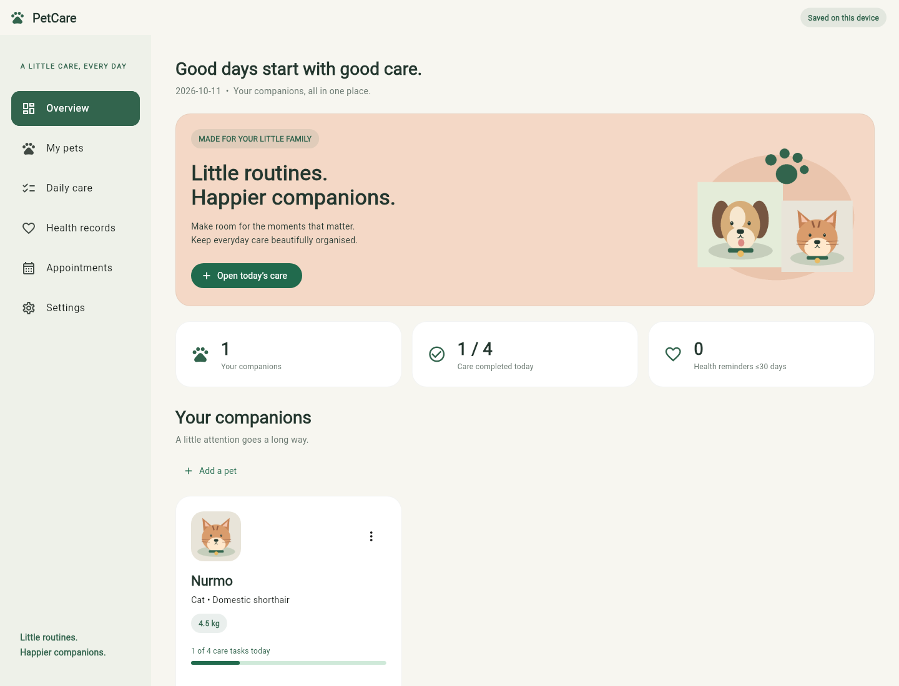
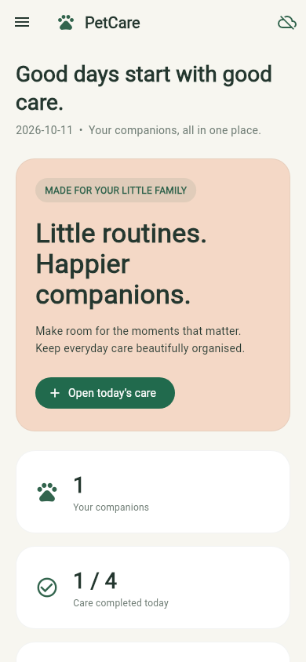

# PetCare Companion

A complete personal pet-care planner built in Flutter and Dart. This is a fresh project; your earlier prototype is not modified or automatically imported.

## Windows quick start

1. Extract this folder to `D:\FlutterProjects\petcare_companion_full` (use a new folder).
2. Double-click `setup_windows.bat`. It installs dependencies, analyzes code and runs tests.
3. Double-click `run_chrome.bat`. Keep its Command Prompt open while using the app.

The scripts use your existing SDK at `D:\flutter`. If your SDK is elsewhere, edit `PETCARE_FLUTTER` in both scripts. Internet access is needed for the first dependency download. Use Flutter 3.32.8 or newer with Dart 3.8 or newer.

Manual commands:

```bat
cd /d D:\FlutterProjects\petcare_companion_full
D:\flutter\bin\flutter.bat pub get
D:\flutter\bin\flutter.bat analyze
D:\flutter\bin\flutter.bat test
D:\flutter\bin\flutter.bat run -d chrome --web-port 7357
```

Open this project folder in VS Code or Android Studio. Edit `lib/main.dart` for screens. Keep the SDK folder `D:\flutter` separate from application projects.

## Screenshots





## Features

- Responsive overview with care progress and upcoming appointments.
- Pet profiles: add, edit, delete and search; name, species, breed, weight, birthday and notes.
- Bundled pet illustrations (dog, cat, other); no external image requests.
- Daily checklist for each pet; custom tasks; check/uncheck and historical dates.
- Health records: vaccinations, checkups, treatments, provider, notes and next due date.
- Health reminders: due within 30 days (including overdue) on the overview.
- Appointments: local date/time, clinic, notes, editing, deletion and completed status.
- Local JSON persistence with ordered writes, save status and retry feedback.
- Copy/view a JSON backup and restore with validation and explicit replacement confirmation.
- Recovery UI if saved data cannot be read; it does not silently overwrite unreadable data.
- Material icon font enabled in `pubspec.yaml` and packaged at build time.

This version is a personal planner, not a clinic system. It has no login, owner management, MySQL server, payments, cloud sync, push notifications, emails or SMS. Reminders are displayed inside the app. Pet photos are not uploaded; supplied artwork is used by species.

## Data and backups

Data is saved with `shared_preferences` under `petcare_companion_v1`. Browser storage belongs to the browser profile and origin. Always run with port **7357**; changing the port gives the browser a different storage location. Private/incognito sessions and clearing browser data may remove records. Closing a tab does not mean cloud backup exists.

Before replacing installations or clearing browser data, open Settings → Copy / view backup. Copy all JSON, paste it into Notepad and save as `petcare-backup.json`. Restore by opening that file, copying its complete text, and pasting it into Settings → Restore backup. Restoration replaces existing data, rather than merging it.

For small personal datasets this keeps setup simple. Shared preferences is not a transactional clinical database; do not use this project to store critical medical records or as a multi-user clinic system. Keep backups. Deleting a pet also deletes their associated health records, appointments and care history after confirmation.

## Android

The Android platform scaffold is included. Install Android Studio and the Android SDK, configure a device/emulator, then run:

```bat
D:\flutter\bin\flutter.bat doctor
D:\flutter\bin\flutter.bat devices
D:\flutter\bin\flutter.bat run -d YOUR_DEVICE_ID
D:\flutter\bin\flutter.bat build apk --release
```

Release signing and Play Store publishing are separate tasks. Android builds require a compatible Java/Gradle/SDK installation. No Android build is claimed in this delivery unless explicitly stated in VALIDATION.md.

## Architecture

| File | Purpose |
| --- | --- |
| `lib/main.dart` | Theme, navigation, screens, forms, user interaction and backup dialogs |
| `lib/models.dart` | Pet and record models, JSON backup validation, daily task history and cascade deletion |
| `lib/storage.dart` | Local persistence adapter |
| `test/data_test.dart` | Persistence, daily isolation, deletion and backup tests |
| `test/widget_test.dart` | Mobile care flow and desktop rendering/navigation tests |
| `assets/` | Original bundled pet artwork |

Appointment times use the device's local time. Care days use calendar date keys. Additions and edits are reflected immediately; check the save indicator before closing. If saving fails, retry or copy a backup.

## Icon troubleshooting

If icons become boxes, stop the app, then run:

```bat
D:\flutter\bin\flutter.bat clean
D:\flutter\bin\flutter.bat pub get
D:\flutter\bin\flutter.bat run -d chrome --web-port 7357
```

The manifest includes `uses-material-design: true`. Do not paste application files into the Flutter SDK's `lib` folder.

## Manual acceptance checklist

- Add one cat and one dog; search and edit profiles.
- Mark Feeding for one pet; the other pet should remain unchanged.
- Reload on the same port; records and task checks should remain.
- Add a custom task; select an earlier date and verify history separation.
- Add a vaccination with a due date; check the reminder count.
- Plan and complete an appointment; edit or delete it.
- Copy a backup, restore it, and verify records.
- Try invalid backup JSON; current data should remain unchanged.
- Delete a pet after confirmation; their associated records should disappear.
- Resize the browser or use a mobile screen and open the navigation drawer.

## Documentation references

- https://docs.flutter.dev/reference/create-new-app
- https://docs.flutter.dev/platform-integration/web
- https://pub.dev/packages/shared_preferences

See `VALIDATION.md` for checks actually completed for this delivery.
